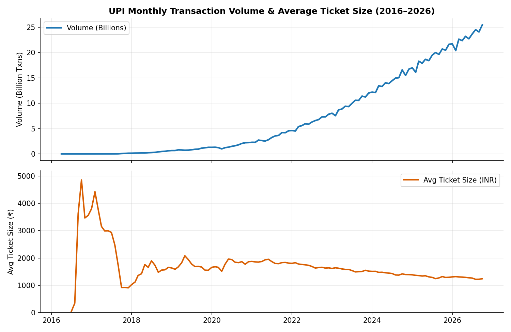
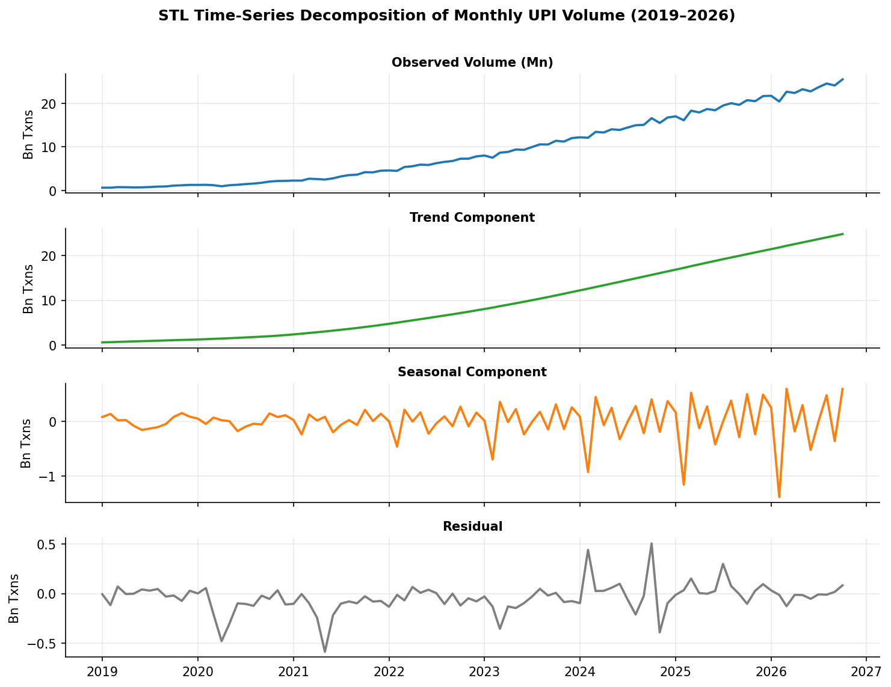
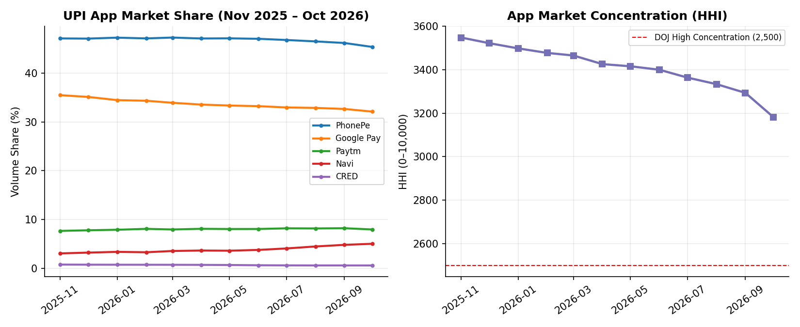
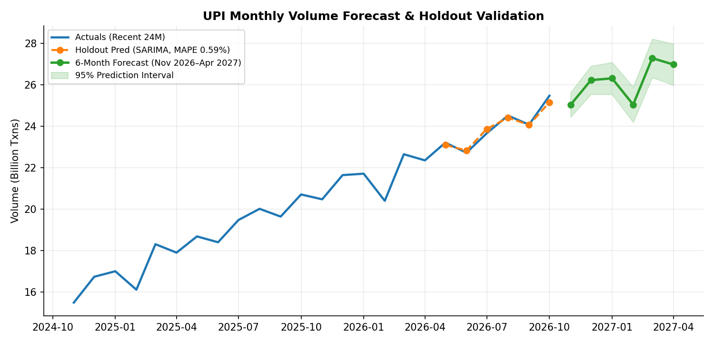

# UPI Digital Payments Trend Analysis (2016–2026)

End-to-end data analytics, PostgreSQL/Neon warehousing, time-series forecasting, and interactive Streamlit dashboard built on **official NPCI UPI Product & Ecosystem Statistics** (127 full months from Apr 2016 to Oct 2026, plus 12 months of app, bank reliability, and P2P/P2M data).

## Key Findings

- **Scale & Maturation:** UPI volume grew **23.02% YoY** to **25.47 billion transactions** (**₹31.53 lakh crore** value) in **October 2026**, while the Compound Monthly Growth Rate (CMGR) moderated from **3.04%** (5-year, Oct 2021–Oct 2026) to **1.80%** (2-year, Oct 2024–Oct 2026).
- **Micro-Payment Adoption (Ticket Size Shift):** Average ticket size fell **32.3%** over five years from **₹1,828.65** (Oct 2021) to **₹1,238.06** (Oct 2026), driven by **P2M (merchant) payments reaching 63.2% of total volume** with an average ticket of **₹603.12** (vs. **₹2,328.40** for P2P).
- **Market Concentration (Duopoly Loosening Slightly):** The top two apps hold **77.43%** of UPI volume (top three: **85.40%**) with an **HHI of 3,181.6** in Oct 2026 — still well above the 2,500 high-concentration threshold, though down from **3,547.6** in Nov 2025.
- **Bank Reliability (Rate vs. Volume-Weighted Impact):** Regional rural banks such as **Baroda U.P. Bank** show the highest Technical Decline (TD%) rates (**2.27%** in Oct 2026; **4.18%** 12-month avg), whereas **State Bank of India** (1.09% TD% on 7,160.29 Mn txns) drives the largest absolute failure volume (**~78.05 million failed transactions** in Oct 2026).
- **6-Month Volume Forecast:** **SARIMA(1,1,1)(1,1,0)[12]** achieved **0.59% MAPE** on a 6-month held-out test set (May–Oct 2026), outperforming Holt-Winters (**0.66% MAPE**) and Seasonal Naive (**18.62% MAPE**), projecting **25.03B – 27.28B** monthly transactions for Nov 2026 – Apr 2027.

---

## Visual Highlights

| Long-Term Growth & Ticket Size | STL Seasonality Decomposition |
| :---: | :---: |
|  |  |

| App Market Share & HHI | 6-Month SARIMA Forecast |
| :---: | :---: |
|  |  |

---

## Project Architecture

```text
upi-trends-analysis/
├── data/
│   ├── raw/                  # 61 official NPCI .xlsx files across 6 categories
│   └── clean/                # Standardized CSVs, forecast outputs, analysis_summary.json, data_dictionary.md
├── etl/
│   ├── clean.py              # Multi-schema Excel parser, normalizer, and sanity-check validator
│   └── load_postgres.py      # Neon / PostgreSQL warehouse loader
├── sql/
│   ├── schema.sql            # Star-schema DDL (fact_upi_monthly, fact_app_share, fact_bank_performance, dim_bank)
│   └── analysis_queries.sql  # Window functions (LAG, rolling avg, RANK, HHI)
├── notebooks/
│   └── run_analysis.py       # Growth, STL decomposition, HHI, TD% hotspots, SARIMA/HW forecasting
├── dashboard/
│   └── app.py                # 5-page interactive Streamlit + Plotly dashboard
├── reports/
│   ├── insights_summary.pdf  # Executive 2-page findings brief
│   └── figures/              # High-resolution charts
└── requirements.txt
```

## How to Run

1. **Install dependencies:**
   ```bash
   pip install -r requirements.txt
   ```
2. **Run ETL & Validation:**
   ```bash
   python etl/clean.py
   ```
3. **Run Analysis & Forecasting:**
   ```bash
   python notebooks/run_analysis.py
   ```
4. **Launch Interactive Dashboard:**
   ```bash
   streamlit run dashboard/app.py
   ```
5. **(Optional) Load into Neon / PostgreSQL:**
   Add `DATABASE_URL=postgresql://...` to `.env`, then run:
   ```bash
   python etl/load_postgres.py
   ```
